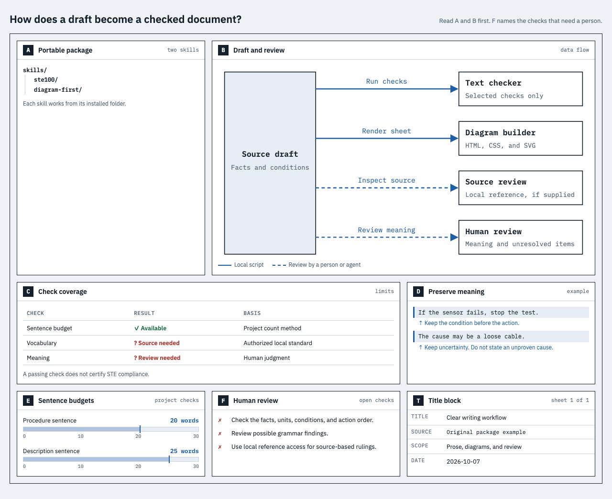

# ste100

Two portable agent skills: `ste100` for clear prose and technical review, and `diagram-first` for native HTML diagrams.

The diagram companion uses Joel Lang's approved [STE100 Wiring Sheet design](https://claude.ai/artifact/RPoZeENf5WKAYYhF4eFtsr). It preserves the grid, fonts, colors, panel styles, and responsive layout. Generated diagrams embed their fonts and need no network access.

This is an unofficial writing aid. It does not certify ASD-STE100 compliance. The package excludes the official standard, dictionary, and copied source examples.

## Start

Copy the full skill folder into your host's skills directory. See [installation](docs/installation.md) for commands. The skills work independently.

| Host | Project folder | Invocation | Evidence |
| --- | --- | --- | --- |
| Codex CLI | `.agents/skills/` | `$ste100`, `$diagram-first` | Documented; clean-copy scripts tested; live host not tested |
| Claude Code | `.claude/skills/` | `/ste100`, `/diagram-first` | Documented; clean-copy scripts tested; live host not tested |
| Grok Build | `.grok/skills/` | `/ste100`, `/diagram-first` | Documented; clean-copy scripts tested; live host not tested |

Use Python 3.11 or later for the bundled helpers. The core checker and renderer use the standard library. Optional local PDF lookup needs `pypdf`.



## Writing modes

`plain` edits general prose with meaning preservation and short sentences. `technical` adds configured budgets for procedures and descriptions. `reference-review` adds targeted lookups in an authorized local standard.

Original example:

Before: “Following the completion of the sample check, you can begin the next test.”

After: “After the sample check, you can start the next test.”

The rewrite keeps the condition and permission. Shorter text alone does not prove compliance.

```sh
python3 skills/ste100/scripts/check_text.py draft.md --mode technical --text-type description --format json
```

The checker reports sentence and paragraph budgets under `ste100-project-count-v1`. Grammar and term-role flags need review. A glossary term does not exempt its sentence from checks. Exit 0 covers selected checks only. See [counting](skills/ste100/references/counting.md).

For optional offline lookup, see [local reference use](skills/ste100/references/local-reference.md). An agent host can receive the returned excerpts in model context.

## Diagram output

```sh
python3 skills/diagram-first/scripts/render_diagram.py examples/diagram-workflow.json --output diagram.html
```

Open `diagram.html` in a browser. Change the JSON facts for a new sheet. The six panels support trees, SVG flows, status tables, annotated examples, numeric bars, and check lists. The title block records source, scope, and date. See [the data format](skills/diagram-first/references/diagram-data.md).

The historical reference remains unchanged. Its old paths, strictness label, and status claims do not describe this release. A controlled browser comparison checks the rendered historical fixture in both themes at desktop, phone, and breakpoint widths.

## Validation

```sh
python3 -m unittest discover -s tests -v
python3 evals/run_evals.py
```

For PDF tests, install `requirements-pdf.txt` first. Without that optional dependency, one synthetic PDF test skips. No test needs the official standard.

See [evaluation](docs/evaluation.md), [visual comparison](docs/visual-testing.md), and [build results](docs/build-results.md). GitHub Actions checks source tests on Linux, macOS, and Windows. It also checks each published release by download, manifest, installation, tests, and diagram render. These checks do not prove live host discovery or model behavior. The evaluation runner validates cases and supplied reviews; it does not make model calls or pass semantic checks from keywords.

To build a release archive, stage the final files and run `python3 scripts/build_release.py --output /path/outside/repo/ste100-release.zip`. The command checks archived files and writes a hash manifest.

Original project content uses MIT. IBM Plex fonts use the SIL Open Font License. See [NOTICE](NOTICE.md) for source and rights details.
